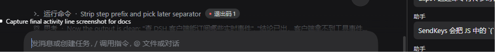
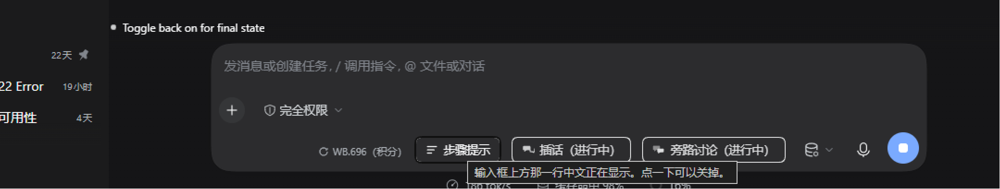

# dsh-dialog-plugin

两个围绕「对话节奏」的小功能，装在 DeepSeek Harness（DSH）桌面版上：

- **插话** —— 助手还在干活时，把一句话直接塞进**正在跑的这一轮**，不用等它跑完。
- **旁路讨论** —— 有分歧时在右侧栏另开一个**独立会话**聊，不打断主线、不污染主会话历史。

外加一个附带的小功能：**中文状态行**，在输入框上方显示一句「这一步在干什么」。

> 目标环境：DSH 0.2.2-rc.5，Electron 桌面版，Windows。

---

## 插话：为什么不是普通发消息

普通消息要排队，等当前回合结束才被读到。插话走的是 `agent/inbox` 的 **steer 通道** ——
消息在**下一个步骤边界**就被注入当前回合，助手当场看到。

| | 普通消息 | 插话 |
|---|---|---|
| 投递方式 | `queue` | `steer`（失败自动回退 `queue`） |
| 被读到的时机 | 本轮结束后 | 下一个 `step` 边界 |
| 用途 | 下一件事 | 纠正、补充、叫停当前方向 |

实测证据（`~/.dsh/dsh-dialog-plugin/inbox.log`）：

```json
{"at":"2026-11-21T12:09:23.792Z","kind":"inserted","sessionId":"session-4381cd64-…","messageId":"e592f60a-…","text":"试试这个插话功能，读到这句话表示一下"}
{"at":"2026-11-21T12:09:27.550Z","kind":"claimed","turn":6,"messageId":"e592f60a-…"}
```

`inserted` → `claimed` 间隔 3.8 秒，**落在同一个 turn 6**，说明消息确实插进了进行中的回合，
而不是等它跑完。

会话日志里对应的落盘事件是 `agent/inbox/spliced`，且 `"target":"next-step"`——
这正是插话与普通消息（`"target":"next-turn"`）的区别。

## 旁路讨论：为什么是 fork

右侧栏 tab 里开的是一个**真正的子会话**，通过 `sessions.fork()` 从当前会话分叉出来。
它能独立跑工具、独立保存历史，主会话完全不知情。

实测：分支里发一条消息，落盘记录只出现在子会话文件（`seq=2685 user/message`），
父会话全文 grep 该消息 **0 命中**。

### 快捷模式：支线默认回答得又短又快

支线的用途是快速对齐一个具体问题，所以每条消息发出前都会自动带上一段固定要求
（先给结论、不复述前文、不列计划、不客套、能一句话说清就停）。

为什么不用参数传：`prompt()` 的 `PromptContentPart` 只有 `text`/`image`/`file`，
没有任何风格开关；`/model` 又是弹面板选的，命令行带参数不生效。能到达分支模型的
只有正文，所以要求写在正文里。

这段指令你不需要看第二遍——讨论栏显示历史时会把它切掉，只在会话原始日志里保留。
讨论栏头部有一行小字「快捷模式：直接给结论，不铺陈。」说明当前是这个模式。

除了在文字上要求简短，支线还会**单独把推理档位降到 `low`**：全局默认（`high`）
是给主对话用的，支线不需要那么深的思考。降档发生在 Host 半边
（`index.js`），只对那一个子会话调 `agent.model.select()`，
**主对话的档位一点没变**——实测支线的 `request/header` 从 `high` 变 `low`，
同一时刻主会话仍是 `high`，profile 里的全局默认也没被改写。

气泡配色也从写死的微信绿改成了跟随主题的中性灰，亮色主题浅灰、暗色主题深灰。

## 中文状态行

DSH 自带的「工作步骤展示」只能控制折叠程度，看不到一句人话的当前动作。
这行从会话事件窗口读最新 `tool/call` 与 `assistant/message`，算出一句话显示在输入框上方。

取词优先级：工具自带的 `description`（最短最像人话） → 助手写的 `▶` 摘要行 → 工具名映射表 → 「正在思考…」。

这一行默认打开，工具行里的 **「步骤提示」按钮** 可以随时关掉它；
开关状态记在 `localStorage`（`dsh-dialog-plugin.activity`），刷新后保持。





---

## 安装

插件目录：

```
dsh-dialog-plugin/          <- 7 个文件，这是要装的那一份
├── package.json
├── cordis.patch.yml
├── client.js               # 浏览器半边，全部 UI 都在这
├── index.js                # Host 半边，只做事件日志
├── icon.svg
└── locale/{zh,en}.json
```

以 desktop profile 为例（把 `<repo>` 换成本地克隆路径）：

```powershell
# 1. 建 link 依赖
cd C:\Users\<you>\.dsh\profiles\desktop
# 在 package.json 的 dependencies 里加一行：
#   "dsh-dialog-plugin": "link:<repo>/dsh-dialog-plugin"
# 并在 dsh.profile.bundles 数组末尾加一项 "dsh-dialog-plugin"

# 2. 建 Junction（Windows 下 link: 依赖靠 junction 解析）
New-Item -ItemType Junction `
  -Path node_modules\dsh-dialog-plugin `
  -Target <repo>\dsh-dialog-plugin

# 3. 让 DSH 装载
#    用 plugin_manager 或 DSH 的插件界面，或直接重启 DSH
```

改 `client.js` 后按 **F5 刷新页面**即可生效（desktop profile 下源文件就是运行文件）。
改 `index.js` 需要重新装载插件。

## 回滚

```powershell
# 看当前状态
powershell -ExecutionPolicy Bypass -File rollback.ps1 -Mode status

# 移除插件（同时清 bundles 与 dependencies，写前自动备份）
powershell -ExecutionPolicy Bypass -File rollback.ps1 -Mode remove

# 恢复
powershell -ExecutionPolicy Bypass -File rollback.ps1 -Mode restore
```

备份落在 `C:\Users\<you>\.dsh\profiles\desktop\rollback-backup\`。

⚠️ **恢复时只 `install_bundle` 不够**，还要 `plugin_manager set_plugin target=include:dsh-dialog-plugin enabled=true`，
否则会「装上了但按钮不出现」。详见 [docs/DETAIL.md](docs/DETAIL.md)。

---

## 已知限制（都是实测撞出来的）

1. **fork 只能从「有已完成回合」的会话发起** —— 正在跑的会话会报
   `session/fork-unavailable: … has no completed turn to fork from`。这是 DSH 的约束。
2. **tab 只能开在「已 adopt」的会话上** —— 否则 `openTabIn` 静默无操作。
3. **输入法会吞字符** —— IME 候选窗抢焦点时，往浮层 textarea 的按键会丢字。
4. **刷新会丢草稿** —— tab 重挂载时输入框内容不保留。
5. **每次 fork 都会在会话列表里多一个条目** —— 设计如此，可手动归档。
6. **主题 token 必须用 `--dsw-alias-*`** —— 写成 `--dsh-color-*` 会全部 fallback，
   在暗色主题下变成白底白字。
7. **浮层没有原生弹窗外观** —— 需要自己的关闭键（Esc 也能关）。

## 文档

- [docs/DETAIL.md](docs/DETAIL.md) —— 实现细节、行号表、四条验收证据、全部踩坑记录

## License

MIT
