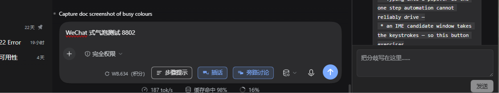
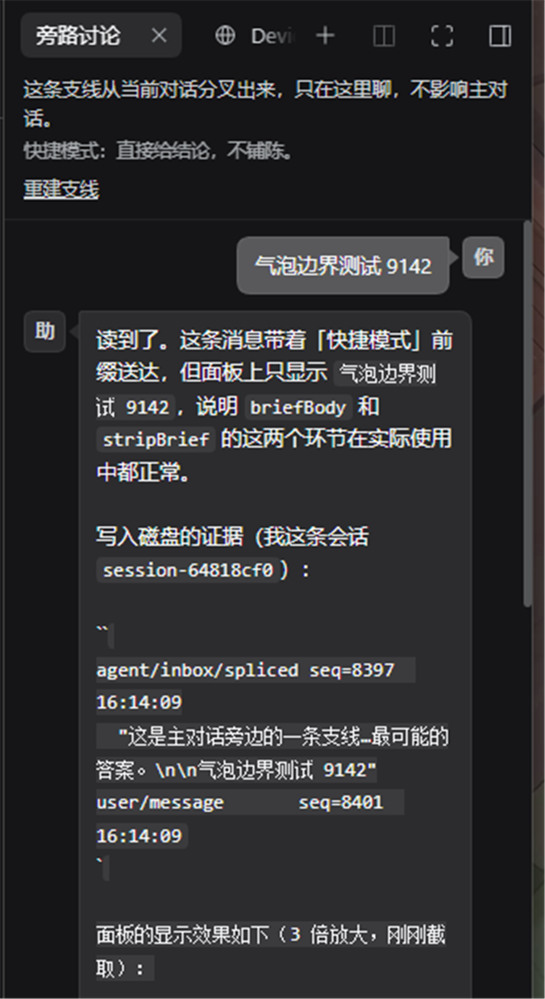
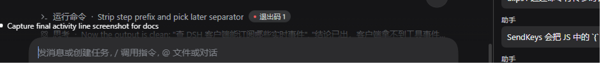
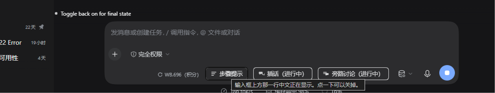

# dsh-dialog-plugin 实现细节与验收记录

写于 2026-11-21。设计目标与验收标准差见 `D:\DSH插件开发\BRIEF.md`，
任务沿革见上级目录的 `HANDOFF.md`。本文记的是**实现层面的细节**、
**实测得到的验收证据**，以及**已知限制和回滚办法**。

- 插件目录：`D:\WB\dsh-dialog-plugin\dsh-dialog-plugin\`
- 装载方式：desktop profile 用 `link:` 依赖 + Junction，改源文件即改运行文件
- 目标环境：DSH 0.2.2-rc.5，Electron 桌面版，Windows

---

## 一、这个插件做两件事

| | B：插话 | A：旁路讨论 |
|---|---|---|
| 入口 | 输入框工具行「插话」 | 输入框工具行「旁路讨论」 |
| 形态 | 浮层（`position:fixed`，z-index 极大） | 右侧栏 tab |
| 目标 | **当前会话**，默认 `steer` 进正在跑的回合 | **fork 出来的子会话**，`queue` |
| 目的 | 助手想偏了立刻纠正 | 有分歧时不打断主线，另开一条支线聊 |

两者互不依赖。B 不需要 A 存在，A 也不需要 B 存在。

此外还有第三件小事（与上面两者也无关）：**中文状态行** —— 在输入框上方
显示一句「这一步在干什么」，解决「思考时看不见进度」。
它只读会话事件，不投递任何消息，见第二节末尾。工具行里的「步骤提示」按钮
可以随时把它关掉/打开，状态记在 `localStorage`，刷新后保持。

---

## 二、代码结构

插件包 7 个文件：

```
dsh-dialog-plugin/
├── package.json          声明 dsh.bundle.patch 与 dsh.client（web, immediately）
├── cordis.patch.yml      只 insert 一行 `- id: dsh-dialog-plugin`
├── index.js              Host 半边：把 Agent inbox 事件写进日志（104 行）
├── client.js             全部 UI（1910 行、约 84 KB，单文件）
├── icon.svg
└── locale/{zh,en}.json   文案
```

### Host 半边（`index.js`）

做两件事：留验收证据，以及给支线降推理档位。

**一、验收证据日志。** 把 `agent/inbox/inserted` 和 `agent/inbox/claimed` 两个事件追加到

```
C:\Users\30823\.dsh\dsh-dialog-plugin\inbox.log
```

每行一个 JSON：`{at, kind, sessionId, turn, messageId, text}`，`text` 截到 400 字符。
写日志失败只 `console.warn`，不向上抛 —— 这条 feed 是 fire-and-forget 的 emit，监听器不能抛。

**`inserted` 与 `claimed` 的区别就是这个插件的验收证据**：

- `inserted` = 消息进了活体 inbox
- `claimed` = 消息被当前正在跑的回合取走

`steer` 会立刻触发 `claimed`；`queue` 要等下一轮才 `claimed`。所以日志能直接回答
「我这句话是插进了当前回合，还是排到下一轮了」。

**二、支线降档（`cheapenBranch`）。** 讨论栏发出去的消息都带
「快捷模式」前缀（`briefBody` 拼的），Host 侧就靠这段前缀认出「这是一条支线」：

```js
const BRANCH_MARKERS = ['这是主对话旁边的一条支线', 'This is a side branch next to the main conversation']
const BRANCH_REASONING_EFFORT = 'low'

ctx.on('agent/inbox/inserted', payload => { … cheapenBranch(payload?.agent, payload?.message) })

function cheapenBranch(agent, message) {
  … 命中前缀后 …
  const current = agent.model.current()
  if (current.reasoningEffort === BRANCH_REASONING_EFFORT) return
  agent.model.select({ provider: current.provider, model: current.model, reasoningEffort: 'low' })
}
```

两个关键点：

- **在 `agent/inbox/inserted` 里改，不在 `agent/pre-step` 里改。** Agent 读
  `model.current()` 是在 pre-step waterfall **之前**（`dsh-agent-loop/lib/index.js`：
  先 `const selection = this.model.current()`，再 `dispatch.waterfall("agent/pre-step", …)`），
  在 pre-step 里改只会影响再下一步。
- **只用 `agent.model.select()`，绝不碰 `session.selectModel` 远程接口。** 后者的
  Host 实现里有 `void this.ctx.agentDefaultModel.saveSelection(selected)`，
  会把全局默认档位一起改掉 —— 用户明确要求「正常对话保持不变」。

Host 半边**不参与投递**。投递走的是 Session Controller 自己的 `prompt` 面。
因此把 Host 半边禁用，UI 仍然全功能 —— 只是没有日志、支线也不会降档。

### Client 半边（`client.js`）

关键函数与行号（行号会随编辑漂移，以函数名为准）：

| 位置 | 内容 |
|---|---|
| `L253` | `sessionFace(sessions, sessionId)` — 拿真正的 `SessionFace` |
| `L288` | `deliverToSession(sessions, sessionId, body, mode = 'steer')` — 唯一投递入口 |
| `L326` | `briefBody(language, body)` — 给支线消息拼上「快捷模式」要求 |
| `L458` | `activityLine(name, argumentsRaw)` — 工具调用 → 一句中文 |
| `L531` | `describeActivity(entries)` — 从事件窗口算出当前这一步 |
| `L591` | `useActivity(sessions, sessionId)` — 订阅事件窗口（只认 `revision` 变化） |
| `L647` | `ActivityLine` — 输入框上方那行状态（关闭时 `return null`） |
| `L708` | `ActivityToggle` — 工具行里的「步骤提示」开关 |
| `L737` | `const ACTIVITY_KEY = 'dsh-dialog-plugin.activity'` — 开关状态 |
| `L773` | `useActivityOn()` — 读开关 + 订阅广播 |
| `L801` | `const PANEL_CSS` — 全部样式，用 `--dsw-alias-*` token |
| `L868` | `ensureStyles()` — 注入/刷新 `<style id="dsh-dialog-plugin-styles">`（内容不一致就覆写） |
| `L928` | `InterjectButton` — 插话按钮 + 浮层（头部带 `×` 关闭键） |
| `L1145` | `const TAB_KIND = 'dialog-branch'` |
| `L1156` | `SideDiscussionButton` — 打开右栏 tab |
| `L1209` | `const TAB_ID = 'dsh-dialog-plugin/branch'` |
| `L1212` | `const BRANCH_KEY_PREFIX = 'dsh-dialog-plugin.branch.'` |
| `L1225` / `L1244` | `readBranch` / `writeBranch` — 每个父会话记住自己的子会话 id |
| `L1278` | `sleep(ms)` — 等新 fork 的子会话把窗口加载出来 |
| `L1290` | `sessionTailSeq(sessions, sessionId)` — 借引用读一个会话的尾部 seq |
| `L1314` / `L1325` | `parentTailSeq` / `childTailSeq` — 两者都转调 `sessionTailSeq` |
| `L1361` | `stripBrief(raw)` — 显示时把「快捷模式」要求切掉（中英都查） |
| `L1455` | `useBranchLog(sessions, sessionId, fromSeq)` — 把子会话事件流变成消息列表 |
| `L1543` | `SideDiscussionTab` — 右栏 body |
| `L1827` | `apply(ctx)` — 全部注册都在这里（插话 `L1866`、旁路讨论 `L1926`、状态行 `L1940`、开关 `L1953`） |

**投递链路**（两个功能共用）：

```
按钮 → deliverToSession(sessions, targetId, body, mode)
     → sessionFace()                        // binding()?.session 优先
     → face.prompt([{type:'text',text}], mode)
```

`sessionFace` 的实现要点（`client.js:253`）：`sessions.binding(id)` 有就直接用；
没有就 `sessions.retain(id, {source:'gateway'})` 借一个，读出 `binding.session`，
然后**延迟 15 秒才 release**（`setTimeout(release, 15000)`）——
因为调用方可能还要 await 一次 prompt，立刻释放会让 face 失效。

`deliverToSession` 的降级策略（`client.js:288`）：`steer` 失败自动重试 `queue`，
确保文本不会因为「回合刚好结束」而静默丢失。

### 右栏 tab 的注册（踩过坑的地方）

```js
ctx.inject(['sidebarRightTabs'], injected => {
  const tabs = injected.get('sidebarRightTabs')
  try {
    tabs.register({ id: TAB_ID, kind: TAB_KIND, keepMounted: true,
                    priority: 'extension', title, guide })
  } catch (error) {
    if (!String(error?.message).includes('is already registered')) warn(error)
  }
})
ctx.slots.inject('sidebar.right.pane.tab', () =>
  ctx.slots.register({ name: 'sidebar.right.pane.tab', key: TAB_ID }, withServices(SideDiscussionTab))
)
```

两个必须记住的点：

1. **必须直接调 `tabs.register(...)`**，不要包 `scope.effect`，不要用
   `scope.sidebarRightTabs` 属性式访问。better-sidebar 就是这么写的。
2. **`try/catch` 必须留**。`sidebarRightTabs` 的 registry 挂在 sidebar-right 包
   自己的 ctx 上，**它的生命周期比一次页面加载长**。F5 之后旧注册还在，
   第二次 `register` 同 id 会抛 `is already registered`。
   早期没有 catch 时，这个异常把 `document.title` 污染成
   `DIALOG-REG-FAIL …already registered`，还把自动化点击脚本搞坏了（按标题找窗口找不到）。

### 工具行三颗按钮：运行状态只用颜色表达

三颗按钮（「步骤提示」30 / 「插话」40 / 「旁路讨论」50）共用 `.dsh-dialog-interject-button`
一个类，但**「开着」和「回合正在跑」是两种不同的状态，用两个不同的属性**：

| 属性 | 谁用 | 含义 | 样式 |
|---|---|---|---|
| `data-on="true"` | 步骤提示开关 | 这个选项是开着的 | 品牌色描边，无填充 |
| `data-busy="true"` | 插话、旁路讨论 | 主对话正在跑，现在点它是有意义的 | 蓝色描边 + 12% 蓝色 tint |

早期两颗按钮在运行时会变成「插话（进行中）」这种带括号后缀的文案，问题是
**按钮宽度会在鼠标悬停时跳变**，正好落在人准备点的那一下。现在文案固定，
运行态只靠颜色。

**颜色选的是写死的蓝色，不是主题 token。** 原因：`--dsw-alias-brand-primary`
在暗色主题下实测就是 `#f9fafb`（那是**前景色**，不是强调色），
拿它做「变色」的标记等于没变。DSH 自己在发送按钮上用的那种蓝
（采样到的值在 `#5d7cb2` ~ `#7aa9fd` 区间）在 token 清单里没有对应变量，
所以这里用两档硬编码色 + `body[data-ds-dark-theme]` 区分：

```css
.dsh-dialog-interject-button[data-busy="true"]{color:#2f6fdd;border-color:color-mix(in srgb,#2f6fdd 58%,transparent);background:color-mix(in srgb,#2f6fdd 12%,transparent)}
body[data-ds-dark-theme] .dsh-dialog-interject-button[data-busy="true"]{color:#7aa9fd;border-color:color-mix(in srgb,#7aa9fd 58%,transparent);background:color-mix(in srgb,#7aa9fd 14%,transparent)}
```

（试过实心填充 `background: var(--dsw-alias-brand-primary)` —— 暗色下就是一块白板，
在深色工具行里过于刺眼，已弃用。）

下图是回合运行中的真实状态：左边「步骤提示」只是开着（描边），
中间两颗「插话」「旁路讨论」是 `data-busy` 的蓝色 tint。三种状态一眼能分开，
没有出现「（进行中）」字样，按钮宽度也不随状态变化：



### 讨论栏的配色与「快捷模式」

讨论栏（右栏 tab）里的气泡早期是微信风格：用户侧实心绿 `#95ec69`、深绿字
`#111a0e`。这组色在 DSH 的暗色界面上很跳，也不跟随主题，所以换成
**由主题 token 混出来的中性面**：

```css
.dsh-dialog-dialog-msg[data-role="user"]{flex-direction:row-reverse;--dsh-dialog-user-fill:color-mix(in srgb,var(--dsw-alias-bg-layer-2) 78%,var(--dsw-alias-label-primary) 22%)}
.dsh-dialog-dialog-msg[data-role="user"] .dsh-dialog-dialog-avatar{background:var(--dsh-dialog-user-fill);color:var(--dsw-alias-label-secondary);box-shadow:inset 0 0 0 1px var(--dsw-alias-border-l1)}
.dsh-dialog-dialog-msg[data-role="user"] .dsh-dialog-dialog-body{background:var(--dsh-dialog-user-fill);color:var(--dsw-alias-label-primary);box-shadow:inset 0 0 0 1px var(--dsw-alias-border-l1);border-top-right-radius:3px}
```

用一个局部变量 `--dsh-dialog-user-fill` 而不是逐处重复 `color-mix`，是为了让
气泡、头像、尖角三处永远同色。底色取 `bg-layer-2` 与 `label-primary` 的 22%
混合（先取 12%，实测两色只差 #454547 / #2c2c2e 一档、看不清，调亮到 22% 后
用户气泡是 #59595b、助手仍是 #2c2c2e，明度差才够），比 assistant 气泡
（纯 `bg-layer-2`）亮一档，**亮色主题下自动变成浅灰、暗色主题下是深灰**，
两边都不用写死颜色。用户侧 `code` 的背景也从 `rgba(0,0,0,.13)` 改成
`rgba(127,127,127,.22)`——在中性灰底上叠纯黑会发脏。

顺带把状态行「刚做完：xxx」前面那个圆点也去绿了：它原来取
`--dsw-alias-state-success-primary`（`#22c55e`）配 `opacity:.8`，是插件里最后一处
绿色，现在改 `--dsw-alias-label-secondary` 配 `opacity:.55`，中性灰。
（`.dsh-dialog-activity[data-tone="done"] .dsh-dialog-activity-dot`）

#### 快捷模式：让支线回答「快、简洁、精确」

支线的用途是快速对齐一个具体问题，但 fork 出来的子会话继承的是父会话的
system prompt，而 `prompt(content, mode)` 的 `PromptContentPart` 只有
`text` / `image` / `file` 三种，**没有任何字段能携带「请简短回答」这类的风格
开关**。（`SessionFace.command()` 只能跑斜杠命令；`/model` 在
`dsh-client-ui-model-selection` 里注册成 `popupSelect`，命令行带参数不生效，
所以「换个小模型」这条路也走不通。）

能到达分支模型的唯一通道就是正文本身，因此每条消息都由 `briefBody()` 在前面
拼一段固定要求：

```js
function briefBody(language, body) {
  return `${text(language, 'panelBrief')}\n\n${body}`
}
```

要求内容是「先给结论、再给一句依据；不复述前文、不列计划、不客套、不总结；
能一句话说清就停；引用只贴相关片段；拿不准就说不确定但仍给最可能的答案」，
中英各一份放在 `DICT` 里。它**每条消息都带**（不是只在 fork 时投一次），
因为支线是连续问答，每一轮都是独立请求。

副作用是这段指令会进会话日志、成为气泡里的第一段。所以 `describeEvent` 读
`user/message` 时用 `stripBrief()` 把它切掉——**中英两本字典都查**，否则在中文
界面里发出的消息切到英文后会把指令露出来：

```js
function stripBrief(raw) {
  if (typeof raw !== 'string' || raw === '') return ''
  for (const table of [DICT.zh, DICT.en]) {
    const brief = table?.panelBrief
    if (typeof brief !== 'string' || brief === '') continue
    if (raw.startsWith(brief)) return raw.slice(brief.length).replace(/^\s+/, '')
  }
  return raw
}
```

为了不让「回答这么短」显得模型在敷衍，讨论栏头部加了一行说明
（`.dsh-dialog-dialog-brief`，读 `panelBriefNote`）：中文「快捷模式：直接给结论，
不铺陈。」，英文「Quick mode: answer straight, no preamble.」

下图是真实界面（3 倍放大）：头部三行是「分叉说明 / 快捷模式 / 重建支线」，
用户气泡是中性灰、右侧带头像，助手气泡是更暗一档的灰、左侧带头像——两种角色
靠位置和明度区分，不再靠绿色：



**端到端证据（2026-11-22 实测）**：从讨论栏输入框真实发出一条问题后，分支会话
`session-107ad3ea-…` 的日志里 `seq=4836 agent/inbox/spliced` 的正文共 153 字，
正是 `panelBrief` 全段 + 空行 + 用户原话：

```
这是主对话旁边的一条支线，用途是快速对齐一个具体问题。回答要求：先给结论，
再给一句依据；不要复述前面对话、不要列计划或待办、不要客套和总结收尾；能一句
话说清就不写第二句；引用代码或命令只贴相关片段。拿不准就直接说不确定，并给出
最可能的答案。

一句话：这个插件的旁路讨论栏是用什么方式把消息送进分支会话的？
```

`stripBrief` 的回环另用 `tools/test-brief.js` 离线验证（9 项断言全过：前缀已加、
原话未损、空行分隔、回切后与原文一致、无前缀消息原样保留、英文段可剥离、
空串与非字符串输入不抛异常）。该脚本从 `client.js` 里按标记切出**真实函数体**
来跑，不是复制粘贴的副本，所以它验证的是即将运行的代码。

#### 支线还单独降推理档位（`low`），主对话保持不动

文字上的「说短点」只影响输出长度，不影响模型思考多久。用户实测「一句话问下去
也要等很久」，所以支线另外把 `reasoningEffort` 从全局的 `high` 降到 `low`。

**为什么不能在客户端做。** `dsh-client-ui-model-selection` 内部调的远程接口
`session.selectModel` 在 Host 侧长这样（`dsh-api-session-controller/src/commands.ts`）：

```ts
agent.model.select(selected)
void this.ctx.agentDefaultModel.saveSelection(selected).catch(…)
```

第二行会**把选中的档位写成全局默认**（落到 profile 的 `cordis.patch.yml`）。
用它降支线档位，主对话下一次也会变 `low` —— 正好违背「正常对话保持不变」。
所以这条路直接排除。

**改成 Host 侧只对那一个 agent 下手。** `agent.model.select()` 只往**本会话**日志追加
一条 `model/selection` 事件，不碰全局默认。触发点选在 `agent/inbox/inserted`：

```js
const current = agent.model.current()
if (current.reasoningEffort === 'low') return
agent.model.select({ provider: current.provider, model: current.model, reasoningEffort: 'low' })
```

**为什么不在 `agent/pre-step` 里改。** `dsh-agent-loop/lib/index.js` 的顺序是
先 `const selection = this.model.current()`、再 `dispatch.waterfall("agent/pre-step", { …, modelSelection: selection })`，
在 pre-step 里改只对**再下一步**生效，第一句依然按 `high` 跑。放在 inbox 插入时改，
同一个回合的第一个 step 就已经是 `low`。

**怎么认出「这是支线」。** `SessionHeader` 区分不出来：普通 fork 的 `parentSession`
可能是空的，`isSeeded` 只说明「含 fork 继承前缀」，旁路讨论的 fork 与其它 fork 没有
可辨别字段。所以认 **内容标记** —— 讨论栏每条消息都带 `panelBrief` 前缀
（`BRANCH_MARKERS` 里存了中英两句开头，必须与 `client.js` 的 `DICT.*.panelBrief` 保持一致）。

**实测证据**（分支会话 `session-64818cf0-…` 的日志）：

```
request/header seq=8515  effort=high      ← 改之前
model/selection seq=8729 {provider: workbuddy, model: deepseek-v4.1-flash, reasoningEffort: low}
request/header seq=8735  effort=low       ← 下一次请求就降下来了
```

同一时刻主会话 `session-4381cd64-…` 的最后一条 `request/header seq=9192` 仍是
`effort=high`；`cordis.patch.yml` 里 `agent-default-model.reasoningEffort` 仍是 `high`
（文件 mtime 也未因这次改动变过）——**「只降支线、主对话不动」两个方向都验到了**。

### 中文状态行（Activity）：把「这一步在干什么」显示在输入框上方

对应 BRIEF 里用户提出的第三个诉求——**思考时看不清进度**。
DSH 自带的「工作步骤展示」只能控制折叠程度，看不到一句人话的当前动作，
所以插件自己补一行。

**注册位**：`conversation.input.dock`，`id: 'dsh-dialog-activity'`，`order: 5`
（该 slot 现有 `todo`(0)、`goal`(10)、`queue`(20)，`replaceRisk: 'none'`，
新 id 是并行追加，不会覆盖别人的条目）。
选上方 dock 而不是下方的 `conversation.composer.dock`，是因为后者已经有
DSH 自己的 `activity` 行，放两行会说同一件事。

**数据来源**（关键，也是唯一可行的路）：Client 侧可订阅的事件只有
`connection/reset`、`locale/change`、`slots/changed`、`theme/change` 四种，
**没有任何 tool/call 实时广播**。所以必须读会话事件窗口：

```js
binding = sessions.binding(sessionId)            // 没有就 retain 借一个
source  = binding.eventSource
window  = source.getSnapshot()                   // { entries, revision }
// snapshot 是原地 mutate 的，只有 revision 变化才代表追加了事件
source.subscribe(read) + setInterval(read, 900)  // 丢帧兜底
```

**讲什么话**，优先级从高到低：

1. **工具自带的 `description`** —— `pwsh` 的 422 次调用里 422 次都带这个字段，
   是最短最像人话的一句（「List plugin project files」）。命中时**原样显示**，
   不再套动词，避免出现「正在执行命令 Refresh and capture…」这种半中半英。
2. **本助手写的 `▶` 行** —— 落在 `assistant/message` 的 `content[].type === 'text'`
   里，且与 `tool-call` 在同一条消息中，所以工具刚开跑时它已经在事件窗内，
   零额外成本、不调模型。会去掉「第 N 步：」这种记账前缀，再按句号/分号/冒号
   截到首句，最后裁到 80 字符。
3. **工具名映射表** —— `ACTIVITY_TOOLS` 里按工具名给中文动词 + 参数摘要
   （`read` →「读文件 client.js」、`grep` →「搜索代码 needle」）。
4. 都没有 → 「正在思考…」。

**只扫描当前 step**：先反向找最近的 `step/start`／`step/end` 拿到 `stepAt`，
再只在 `[stepAt, end]` 里找 `tool/call` 与 `assistant/message`。
早期版本没有这层边界，导致整个回合都在显示上一个 step 的旧动作（自查发现的 bug）。

**验证方式**：`D:\DSH插件开发\tools\test-activity.js` 把 client.js 里的纯函数
切片出来（`new Function` 注入 `detectLanguage`），解码真实会话的 zstd 文件，
回放投喂 `describeActivity`，打印每个探针点的输出。不用开界面就能验算法。

实际渲染效果（输入框上方那一行，圆点 + 一句话）：



这张图里显示的是 `Capture final activity line screenshot for docs` ——
工具自带的 `description` 被原样发布，没有套「正在执行命令」这种外壳，
这就是为了让句子短、能一眼看完。

**开关**：这一行默认打开，工具行里有一颗「步骤提示」按钮可以关掉它。

- 位置：`conversation.input.right`，`id: 'dsh-dialog-activity-switch'`，`order: 30`
  —— 排在「插话」(40)、「旁路讨论」(50) 之前，所以工具行读起来是
  「显示什么」然后「能做什么」。
- 状态存在 `localStorage` 的 `dsh-dialog-plugin.activity`：值为 `'off'` 表示关闭，
  **键不存在表示打开**（默认开，不然首次使用会看到一片空白，不知道有这个功能）。
- 打开时按钮用 `data-on="true"`（品牌色描边）表示「正在显示」，关闭时回到普通描边。
  **这个开关刻意不复用旁边两颗按钮的 `data-busy`**：`data-busy` 现在是一块实心填充，
  一颗常亮的实心按钮会被读成「正在发生什么」，而不是「这个选项是开的」。
- 两处都读同一个 `useActivityOn()` hook，内部用 `Set` 订阅广播，
  所以点按钮和状态行之间是即时同步的，不需要刷新。
- 关闭时 `ActivityLine` 直接 `return null`，但 `useActivity` 仍然订阅
  （hook 在 return 之前调用），因此重新打开是瞬时的，不会闪一下「正在思考…」。

验证过的四种状态（截图在会话记录里）：

| 操作 | 结果 |
| --- | --- |
| 默认加载 | 输入框上方出现 `● 说明文字`，「步骤提示」按钮高亮 |
| 点一下按钮 | 该行消失，按钮变暗，tooltip 变「已关闭，点一下重新打开」 |
| 再点一下 | 该行立刻回来，tooltip 变「正在显示，点一下可以关掉」 |
| 关闭后按 F5 | 仍然是关闭状态（localStorage 生效），按钮仍在原位可点 |

下图上半是状态行本身，下半是工具行里那颗「步骤提示」按钮
（此时为打开状态，所以带品牌色描边）：



---

## 三、验收证据

四条验收标准的实测结论与证据位置。

### ① 插话入口能提交且消息确实进当前会话 —— 通过

Host 日志 `C:\Users\30823\.dsh\dsh-dialog-plugin\inbox.log` 里的原始记录：

```json
{"at":"2026-11-21T07:45:34.909Z","kind":"inserted",
 "sessionId":"session-6f9a852b-f0e2-4c1d-9f3e-0bd0e0081e9a",
 "messageId":"c8494a0f-53c4-4757-b0bd-278e412e28a0",
 "text":"插话插件自测：这条消息由「自测投递」按钮发出，用来确认 steer 通路可用。"}
```

随后同一 `messageId` 出现 `kind:"claimed"` —— 证明消息是被**当前回合**取走的
（steer 生效），不是排到下一轮。

浮层三处显示缺陷修完之后又做了一次**真实输入**的端到端复验
（2026-11-21 20:02，粘帖「插话修复后的真实发送验证」后点「插话」）：

```json
{"at":"2026-11-21T12:02:12.994Z","kind":"inserted",
 "sessionId":"session-4381cd64-b1ef-47d6-9b5d-130ea8ccb914",
 "messageId":"d7e88272-e800-48a1-82da-3fbfaf5c3908",
 "text":"插话修复后的真实发送验证"}
{"at":"2026-11-21T12:02:17.396Z","kind":"claimed", … "turn":5,
 "messageId":"d7e88272-e800-48a1-82da-3fbfaf5c3908"}
```

会话文件里对应 `seq=3568 type=agent/inbox/spliced {"target":"next-step",…}`
与 `seq=3575 type=user/message {"source":{"kind":"user","rpcId":"7df1e870-455c-4dec-93c3-f7a48830270d"}}`。
注意 `target` 是 **`next-step`**（不是 `next-turn`）—— 这就是「插话」与普通消息的区别。

### ② 讨论栏能独立对话、主会话不受影响 —— 通过

这一条做了两次，第一次只有「自测发送」按钮的证据，第二次是**真实键盘输入 + 点发送**。

界面操作：点右栏输入框 → `SendKeys` 输入 `A-side-check-7701` → 点「发送」。

落盘证据在分支会话
`C:\Users\30823\.dsh\sessions\--D-DSH~63D2~4EF6~5F00~53D1--\session-35ac992d-e8c4-4ebe-bfe3-7fd466594b90\session.v4.jsonl.zstd`：

```
seq=2681  agent/inbox/spliced  {"target":"next-turn", ...,
          "text":"A-side-check-","rpcId":"af21d6e6-c448-40d4-a4f8-408c417d147a"}
seq=2682  turn/start           {"turn":5}
seq=2685  user/message         {"text":"A-side-check-",
          "source":{"kind":"user","rpcId":"af21d6e6-c448-40d4-a4f8-408c417d147a"}}
```

（输入框实际只收到 `A-side-check-`，后 4 位被 IME 候选窗吞了，见下文限制第 3 条。）

**主会话不受影响**的证据：父会话 `session-0fa2edf1-…-2c42e5857b11` 全文解码后
grep `A-side-check` = **0 命中**，且文件 mtime 停在操作前不再增长。
其余同期会话同样 0 命中。

> 附注：会话文件是 `.zstd`，但实际由**多个独立 zstd frame 顺序拼接**。
> `zlib.zstdDecompressSync` 只解第一个 frame，必须按 magic `28 B5 2F FD` 切帧逐个解。
> 解码脚本见 `D:\DSH插件开发\tools\unzstd.js`。

### ③ 关插件后界面恢复、DSH 正常启动 —— 通过（启动部分用间接证据）

执行 `rollback.ps1 -Mode remove` → F5 之后截图
`D:\DSH插件开发\shots\rb20-removed.png`：

- 输入框下方「插话」「旁路讨论」两个按钮**全部消失**
- 右栏不再自动出现「旁路讨论」tab
- 会话正文、模型选择、发送按钮、左栏会话列表全部正常
- 进程没有崩溃，没有残留报错

`plugin_manager list_plugins`（218 个 entry）里已无 `dsh-dialog-plugin` 的任何 row。

**关于「DSH 正常启动」**：无法用 CLI 单独验证 desktop profile ——

```
$ dsh --profile desktop
error: profile "desktop" is managed exclusively by the Electron application
```

（`--dump-config` 也输出空。）所以这一项只能以「插件卸载状态下页面 F5 正常渲染、
进程未崩、无报错」为证据。这是 DSH 的设计约束，不是验证遗漏。

### ④ 有回滚脚本且实测回滚过一次 —— 通过

脚本：`D:\WB\dsh-dialog-plugin\rollback.ps1`（纯 ASCII，4983 字节为改版前，
当前版本 8520 字节）。

```
powershell -NoProfile -ExecutionPolicy Bypass -File rollback.ps1                 # 只报告
powershell -NoProfile -ExecutionPolicy Bypass -File rollback.ps1 -Mode remove
powershell -NoProfile -ExecutionPolicy Bypass -File rollback.ps1 -Mode restore
```

实测双向记录（同一天连续做的）：

| 步骤 | 结果 |
|---|---|
| `status` | `installed state: installed`，exit 0 |
| `remove` | 备份 `rollback-backup\package.json.20261121-192236.bak`，bundles 12→11 项，依赖项删除，exit 0 |
| F5 | 按钮与 tab 入口消失（`rb20-removed.png`） |
| `restore` | 备份 `…-192257.bak`，bundles 11→12 项（末位），依赖 `link:` 补回，exit 0 |
| F5 | 按钮与 tab 回来（`rb21-restored.png`） |
| `status` | `installed state: installed`，exit 0 |

脚本同时编辑**两处**：`dsh.profile.bundles`（挂载哪些 bundle）和
`dependencies["dsh-dialog-plugin"]`（pnpm 的 `link:` 依赖）。
只改一处会让 package.json 自相矛盾 —— 早期版本就出现过这种半残状态，见下文。

---

## 四、已知限制（都是实测撞出来的，不是猜测）

### 1. fork 只能从「有已完成回合」的会话发起

在正在跑的会话里点「开始讨论」会报：

```
支线功能建立: session fork failed: session/fork-unavailable:
session-"session-4381cd64-…" has no completed turn to fork from
```

这是 `sessions.fork` 的固有约束，不是插件 bug。插件把这个错误识别成
「等待中」状态（`client.js:981` 判断 `fork-unavailable`），显示
`panelWaitTurn` 提示，而不是当成故障。**会话跑完一轮之后再来点就能 fork。**

### 2. tab 只能开在「已 adopt」的会话上

`sidebarRight.openTabIn(sessionId, kind)` 在会话 store 未 adopt 时**静默无操作**
（源码如此：`const actions = this.actionsFor(sessionId); if (actions !== undefined) …`）。
插件因此做了两层兜底（`client.js:621-633`）：

1. 先 `openTabIn(sessionId, TAB_KIND)`
2. 再 `openTab(TAB_KIND)`
3. 最后用 `sidebarRight.tabsIn?.(sessionId)` 校验，失败提示
   `'tab did not open — no adopted store for this session'`

### 3. 输入法会吞字符

`SendKeys` 打字时 IME 候选窗会抢焦点，实测输入 `A-side-check-7701` 只落进
`A-side-check-`。**这是 Windows 输入法行为，不是插件问题**，真实用户手动打字不受影响。
但它意味着自动化测试不能依赖精确文本。

同理，`imm32.dll ImmAssociateContextEx(hwnd, IntPtr.Zero, 0)` 想解绑 IME 会返回
False / err=203，此路不通。

### 4. 刷新会丢草稿

右栏 tab 在 F5 / 重新挂载时会整个重建，输入框里没发出去的草稿会丢
（实测 `rev` 从 2580 掉到 523，输入框变回 placeholder）。
分支会话 id 存在 localStorage，不会丢；丢的只是**没发出的草稿**。

### 5. 每次 fork 都会在会话列表里多一个条目

这是刻意不做 auto-fork 的原因（`client.js:998-1000` 有注释）：
如果挂载即 fork，每次刷新都会多留一个 fork 出来的会话。
现在是**用户点「开始讨论」才 fork**，id 按父会话记在 localStorage。

### 5.1 讨论栏会重放主会话历史 —— fork 边界必须显式传 `atSeq`

**现象**：右栏讨论栏里出现了主对话几分钟前才说的话，看起来像「讨论栏读了主会话」，
而且发出去的消息也不创建新支线。

**根因**：`fork` 出来的子会话是父会话的完整副本，插件要记一条「边界 seq」，
表示「这个 seq 以下是继承来的，不要显示」。旧实现是 fork **之后**去读子会话窗口的
尾部 seq：

```js
await sessions.fork({ sessionId: parentId, increaseTitle: true, onCreated })
const probe = sessions.retain?.(childId, { source: 'gateway' })
let from = 0
try { from = tailSeqOf(probe.binding?.eventSource) } catch { from = 0 }
```

fork 刚返回时子会话的事件窗口还在异步加载，`getSnapshot().entries` 可能是空数组，
`tailSeqOf` 就返回 0。而 `from: 0` 的语义是「从 seq 0 全量显示」，
于是 `messagesFromEntries` 把继承来的整段父历史都渲染出来 —— 面板看起来就是主会话。

**修法**（`client.js` 的 `startBranch`）：边界改在 fork **之前**从**父会话**读，
并把它显式传给 `fork` 的 `atSeq`；只有父会话本身是空的时候才 `from = 0`：

```js
const boundary = parentTailSeq(sessions, parentId)   // 读父会话尾部 seq
await sessions.fork({
  sessionId: parentId,
  ...(boundary > 0 ? { atSeq: boundary } : {}),
  increaseTitle: true,
  onCreated: created => { childId = created },
})
let from = boundary
if (from === 0) {
  // 父窗口读不到时才退回读子会话，且重试几次等它加载
  for (let attempt = 0; attempt < 6 && from === 0; attempt += 1) {
    from = childTailSeq(sessions, childId)
    if (from === 0) await sleep(120)
  }
}
```

`parentTailSeq` / `childTailSeq` 都走同一个 `sessionTailSeq(sessions, id)`：
`retain(id, { source: 'gateway' })` 借一次引用读窗口尾部，`finally` 里 `release`。

**验证**（实测）：在会话 `session-4381cd64`（maxseq 8393）点「开始讨论」，
新 fork 出 `session-64818cf0`，面板显示 **「还没有消息，说点什么开始。」**
（修之前这里会铺满主会话历史）；随后输入并发送 `气泡边界测试 9142`，
落到 `session-64818cf0` 的 `agent/inbox/spliced seq=8397` 与 `user/message seq=8401`，
主会话与其他会话里该串 **0 命中**。

### 6. 主题 token 必须用 `--dsw-alias-*`（踩过两个坑）

第一条：插件最早的 `PANEL_CSS` 把颜色变量全写成 `--dsh-color-*`，**这些变量在 DSH
里根本不存在**，于是 `var()` 的 fallback 全部生效：浮层背景变成 `#fff`，
文字 `inherit` 到暗色主题的浅色 —— 白底白字，连同「取消」等 ghost 按钮的边框
（6% 白）一起，表现为「两个空白框」。

真实 token 名来自 `cordis_inspect_query(platform=client, provider=Theme,
method=listTokens)`，全部 `requiresLightAndDark`：

```
--dsw-alias-bg-base  -bg-layer-1  -bg-layer-2  -bg-overlay
--dsw-alias-border-l1  -border-l2
--dsw-alias-brand-primary  -label-primary  -label-secondary
--dsw-alias-state-error-primary  -state-idle-primary  -state-success-primary  -state-warn-primary
--dsw-specific-sidebar-fill
```

暗色主题下实测值：

```
brand=#f9fafb  bgBase=#151517  bgL1=#232324  bgL2=#2c2c2e  overlay=#61666b
b1=#ffffff0f  b2=#ffffff1f  lbl=#f9fafb  lbl2=#cfd3d6
idle=#545557  succ=#22c55e  warn=#f59e0b  err=#f25a5a
```

**关键陷阱：`--dsw-alias-brand-primary` 在暗色下是 `#f9fafb`，那是「前景色」
不是「背景色」。** 拿它当 primary 按钮底色、再配 `color:#fff`，就是白底白字。
正确写法是 `background: var(--dsw-alias-brand-primary)` +
`color: var(--dsw-alias-bg-base)`（暗色下深字，亮色下自动反转）。
ghost 按钮的边框要用 `--dsw-alias-border-l2`（12% 白），
`-border-l1`（6% 白）在深色底上几乎看不见。
浮层背景用 `--dsw-alias-bg-layer-1`，与 DSH 面板一致
（`dsh-better-sidebar/src/client/sidebar.module.css:13-21` 的约定是
「只用 `--dsw-alias-*`，绝不用 `--dsw-specific-sidebar-fill`」）。

第二条（更隐蔽）：`ensureStyles()` 原来写成
「`document.getElementById(id) !== null` 就 `return`」。
F5 会重新执行 client 模块，但 DOM 里那个 `<style>` 还在，
于是**永远沿用首次加载的旧 CSS，改样式刷新后看着毫无变化**。
现在改成内容不一致就覆写：

```js
if (existing.textContent !== PANEL_CSS) existing.textContent = PANEL_CSS
```

排查手段见本节末尾「探针法」。

### 7. 浮层没有原生弹窗外观，需要自己的关闭键

浮层是 `createPortal(...)` 挂到 `document.body` 的普通 `div`，
不是 DSH 的 dialog 组件，所以没有标题栏也没有系统关闭按钮。
用户反馈「为什么没有收起的按键」就是这个原因 ——
其实 `Esc` 一直能关（`client.js:429-444` 的 keydown 监听），但界面上看不出来。
现在头部有一行「插一句话进当前回合」+ 右侧 `×`
（`.dsh-dialog-interject-close`，`onClick: close`，
`title`/`aria-label` 取 `text(language,'cancel')`）。

> 两个「自测」按钮（插话浮层的「自测投递」、右栏的「自测发送」）
> 曾经是为了绕开 IME 抢焦点而加的临时验收路径，**已经全部删除**
> （2026-11-21，按用户要求）。现在插话浮层只剩「取消 / 插话」，
> 右栏只剩「发送」。

### 8. 粗体标记只有成对才渲染

讨论栏的 `renderInline` 用 `/\*\*([^*]+)\*\*|`([^`]+)`/g` 逐段解析，
所以 `**粗体**` 必须成对出现。模型输出偶尔会漏掉后半个 `**`
（整段文本里 `**` 的总数为奇数），那一对就永远匹配不上，
`**` 按字面显示。

实测统计（分支会话 141 条带正文的 assistant 消息）：`**` 数量为奇数的只有 2 条，
正常配对的 57 条全部渲染成了 `<strong>`。所以这不是渲染器的 bug ——
它宁可保留字面量，也不吞掉后文；反引号不受影响，因为
`` `([^`]+)` `` 是逐对匹配，未配对的反引号不会改变后面配对的起点。

**排查提示**：如果看到某个气泡里的 `**` 没生效，先数那个气泡里 `**` 的个数是不是偶数，
不要怀疑 CSS 或组件没加载。

---

## 五、回滚与恢复

### 正常回滚（推荐）

```powershell
powershell -NoProfile -ExecutionPolicy Bypass -File D:\WB\dsh-dialog-plugin\rollback.ps1 -Mode remove
```

然后 F5 刷新页面。插件从 profile 里摘掉，按钮和 tab 入口消失。

需要恢复时：

```powershell
powershell -NoProfile -ExecutionPolicy Bypass -File D:\WB\dsh-dialog-plugin\rollback.ps1 -Mode restore
```

再 F5。脚本会补齐 bundle 条目、`link:` 依赖，junction 缺失时重建。

每次改写 profile 前都会 `Copy-Item` 到
`C:\Users\30823\.dsh\profiles\desktop\rollback-backup\package.json.<yyyyMMdd-HHmmss>.bak`，
写回用 `UTF8Encoding($false)`（无 BOM，与 DSH 自己写的一致）。改坏了直接拷回去即可。

### 用 DSH 服务做回滚（等价路径）

```
plugin_manager action=set_plugin    target=include:dsh-dialog-plugin enabled=false
plugin_manager action=remove_bundle target=dsh-dialog-plugin
```

### ⚠️ 恢复时的一个大坑（实测踩过）

**只跑 `install_bundle` 是不够的。**

`set_plugin enabled=false` 会在 profile 里留下一条
`include:dsh-dialog-plugin` 的 `enabled:false` 记录。
`install_bundle` 不会清掉它 —— 结果是 bundle 装回来了，但 entry 仍然 disabled，
**界面上一根按钮都不出现**，`plugin_manager list_plugins` 里能看到
`"enabled": false, "fiberPhase": null`。

正确恢复顺序是两步：

```
plugin_manager action=install_bundle target=D:\WB\dsh-dialog-plugin\dsh-dialog-plugin
plugin_manager action=set_plugin     target=include:dsh-dialog-plugin enabled=true
```

### ⚠️ 第二个坑：junction 被删掉会变成「半残状态」

`remove_bundle` / `install_bundle` 折腾过程中，
`C:\Users\30823\.dsh\profiles\desktop\node_modules\dsh-dialog-plugin`
这个 Junction 可能被删掉，而 package.json 里依赖和 bundles 还在。
这时 DSH 报：

```json
{"availability":"missing",
 "error":{"code":"operation-error",
          "diagnostic":"dsh: cannot resolve profile bundle \"dsh-dialog-plugin\" …"}}
```

界面上按钮全消失，`set_plugin enabled=true` 还会报 `unaddressable`
（因为 `availability:missing` 时那条 row 根本不存在，entry 不可寻址）。

修法是**先手工重建 junction，再 enable**：

```powershell
New-Item -ItemType Junction `
  -Path C:\Users\30823\.dsh\profiles\desktop\node_modules\dsh-dialog-plugin `
  -Target D:\WB\dsh-dialog-plugin\dsh-dialog-plugin
```

然后 `plugin_manager set_plugin target=include:dsh-dialog-plugin enabled=true`
→ 返回 `application: applied`，条目恢复 `availability: "profile"`，F5 后界面恢复。

用 `rollback.ps1 -Mode restore` 就不会碰到这个问题 —— 脚本会检查 junction 并在缺失时重建。

### 右栏残留一个空 tab 是正常的

回滚后如果右栏还留着「旁路讨论」tab，它显示
「这类内容还没有可用的查看方式」或 `tab.unavailable`。
这是 sidebar 给「没有注册者的 kind」渲染的正常提示，不是故障，关掉即可。

---

## 六、开发期的操作要点

### 改动生效方式

| 改的是 | 生效方式 |
|---|---|
| `client.js` | `SetForegroundWindow(hwnd)` + F5（或用 `ui.ps1 -Action keys -Text '{F5}'`） |
| `index.js`（Host） | `plugin_manager set_plugin target=include:dsh-dialog-plugin enabled=false` 再 `true` |
| 两个都改 | 先 Host 重载，再 F5 |

### 该插件的运行文件就是源文件

`D:\WB\dsh-dialog-plugin\dsh-dialog-plugin\` 通过 Junction 挂进
`C:\Users\30823\.dsh\profiles\desktop\node_modules\dsh-dialog-plugin`，
**改源文件就是改运行文件，不需要重装、不需要 pnpm install。**

### 写 .ps1 必须注意编码

PowerShell 5.1 会把**无 BOM 的 UTF-8 .ps1 当成 ANSI 解析**，
文件里有中文就会报 `Missing expression after ','` / `Unexpected token '{'`，
能跑起来也会输出一堆乱码。

两个应对：脚本写成纯 ASCII（`rollback.ps1` 就是这么做的，中文说明全在本文里）；
或者写成带 BOM 的 UTF-8。

另外 PowerShell 执行策略禁止直接跑 .ps1，必须：

```powershell
powershell -NoProfile -ExecutionPolicy Bypass -File <path>
```

### 自动化操作 DSH 窗口

工具脚本 `D:\DSH插件开发\tools\ui.ps1`，动作 `shot/move/click/clickshot/keys/type/enter`，
坐标是**屏幕绝对坐标**。

- 必须用 **danger-full-access** 权限跑：Low 完整性级别下 `SetCursorPos` 返回 False、
  err=5，`SendInput` err=203，光标纹丝不动（UIPI 拦截）。
- `-Action shot` 必须显式传 `-Out` 的 ASCII 路径，否则默认路径含乱码并在
  `Image.Save` 抛 `A generic error occurred in GDI+`。
- 没有 `focus` 动作（传了会打印 `unknown action: focus`）。
- 靠进程名 `DeepSeek Harness` 找 hwnd，不要靠窗口标题 ——
  标题会被页面自己的 `document.title` 改写（见上文 DIALOG-REG-FAIL 事故）。
- **坐标每次都要重新截图定位**，右栏开合会让按钮横向漂移一大截。

### 探针法：在页面里读值并带出来

DevTools Console 的粘贴通道不可用 —— 它会先弹
`Warning: Don't paste code into the DevTools Console that you don't understand…
Type 'allow pasting' below and press Enter`，
而用 SendKeys 敲 `allow pasting` 会**丢掉空格**变成 `allowpasting`，
Console 报 `Uncaught ReferenceError: allowPasting is not defined`。
自动化没法在 Console 里执行 JS。

替代通道（实测可用）：在 `client.js` 的 `apply(ctx)` 里临时插一段
`setTimeout(..., 1500)`，构造游离 DOM，读 `getComputedStyle` / `getPropertyValue`，
把结果拼成一个字符串写进 `globalThis.document.title`，
再用 PowerShell 从窗口标题读回来：

```powershell
Add-Type @'
using System;
using System.Runtime.InteropServices;
using System.Text;
public class WT {
  [DllImport("user32.dll", CharSet=CharSet.Unicode)]
  public static extern int GetWindowTextW(IntPtr h, StringBuilder s, int n);
}
'@
$p = Get-Process -Name 'DeepSeek Harness' | Where-Object { $_.MainWindowHandle -ne 0 } | Select-Object -First 1
$sb = New-Object System.Text.StringBuilder 4096
[WT]::GetWindowTextW($p.MainWindowHandle, $sb, 4096) | Out-Null
$sb.ToString()
```

两条注意：

- 探针写进的是 `document.title`，会**覆盖窗口标题**，用完必须删掉
  （否则 `ui.ps1` 曾经靠标题找窗口就会直接失效，见 DIALOG-REG-FAIL 那段）。
- 探针块在 `client.js` 里留过 67 行，删完后要重新 `node --check` 并刷新两次确认
  标题回到正常值。

---

## 七、与本插件无关的环境噪声

排查时容易误认成插件 bug，记录在此：

- 主会话正文偶现
  `本轮运行失败 400: {"message":"workbuddy upstream client (http 422)…","code":"bili_gate_oversize_refusal_unattributed_bytes"}`
  —— billion-context 的压缩门拒绝超大字节，属上下文管理问题。
- 分支 agent 自己的 `cordis_inspect_query` 报
  `Error: Client Cordis inspect provider "Sessions" is not registered`
  —— Client 侧可枚举的 Service/Provider 本来就少（见 HANDOFF 第三节），不是插件问题。
- `@michengai/dsh-codex-ui@1.1.38` 因版本不兼容被拒（`incompatible-version`），
  与插件无关。

---

## 八、清理清单（交付前）

已执行（2026-11-21）：

| 删掉的 | 说明 |
|---|---|
| `shot-8.png`、`shot-36..54*.png`（21 张） | 开发期一次性截图，每张 1.5MB 左右 |
| `tmp-branch.jsonl`（7.1MB） | 会话解码的中间产物 |
| `tmp-child.js`、`tmp-probe.js`、`tmp-sources.js`、`tmp-zstd.js` | 一次性解码/探测脚本 |
| `acl-report/` | 权限排查产物，与插件最终形态无关 |

合计约 27 项 / 22.2 MB。

保留：`HANDOFF.md`（沿革）、`docs/DETAIL.md`（本文）、`rollback.ps1`、
`dsh-dialog-plugin/`（插件本体）、`research/`（源码参考，可选）、
`backup/`（⚠️ 里面那份 `package.json` 其实**仍含插件**，不是真回滚基线，
勿当作基准；真正的回滚基线由 `rollback.ps1` 每次写前自动备份到
`C:\Users\30823\.dsh\profiles\desktop\rollback-backup\`）。

最后状态（2026-11-22 17:45）：`client.js` 87886 字节 / 1965 行，`index.js` 6578 字节，
两者 `node --check` 均 exit=0，
插话浮层与右栏都只剩真实按钮，中文状态行已上界面并带「步骤提示」开关
（开关状态存 `localStorage` 的 `dsh-dialog-plugin.activity`，刷新后保持），
运行态文案后缀已去掉、只靠颜色（`data-busy` 蓝色描边 + tint），
讨论栏用户气泡已从微信绿改为主题中性灰（`color-mix` 78%/22%，实测用户
`#59595b` / 助手 `#2c2c2e`），状态行「刚做完」圆点也去绿，
支线消息带「快捷模式」要求且显示时被切掉，支线会话的 `reasoningEffort`
由 Host 侧降到 `low`（实测 `request/header` 从 `high` 变 `low`，主会话仍 `high`），
全项目 grep `selftest|自测|sendProbe|PROBE|TEMPORARY|dsh-color|DIALOG-REG-FAIL|进行中|#95ec69|state-success-primary` 零命中。

恢复基线：`D:\WB\dsh-dialog-plugin\backup\client.js.before-activity`
（56822 字节，即加状态行之前的版本），要退掉状态行直接覆盖回去再 F5。
只退开关、保留状态行：删掉 `apply()` 里 `id: 'dsh-dialog-activity-switch'` 那次
`ctx.slots.register`，并把 `ActivityLine` 第一行的 `const [on] = useActivityOn()`
与 `if (on !== true) return null` 一并去掉。
只退「支线降档」、保留其它：删掉 `index.js` 里 `apply()` 中
`cheapenBranch(payload?.agent, payload?.message)` 那一行（以及不再使用的
`BRANCH_MARKERS` / `BRANCH_REASONING_EFFORT` / `isBranchText` / `cheapenBranch`），
日志功能不受影响。
